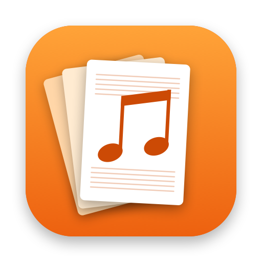

<p align="center">
  
</p>

<h1 align="center">Copista</h1>

<p align="center">
  A Mac app for the sheet-music librarian. Drop in the PDFs for a song, and Copista sorts the
  pages into instrument parts and prints the right number of copies of each.
</p>

---

Copista was made for the music library of a Swedish wind band, where a song comes as anything
from one PDF per part to a single scanned stack of every part. It finds where each part begins and
which instrument it's for. You fix what it got wrong, and it prints each song, sorted by part and
ready to hand out.

## Features

- **Reads the music it's given.** Copista recognizes parts from PDF bookmarks, file names, the
  PDF's text, or by reading the top of each scanned page with on-device OCR. It understands
  Swedish and English part names, common German ones, abbreviations, and garbled old hand
  lettering.
- **One part runs until the next begins.** Pages without a name of their own belong to the part
  before them. A new part starts where an instrument's name appears in a top corner, or on a line
  of its own.
- **Review that tells you what to do.** Pages are grouped by section and instrument, in score order.
  Anything uncertain is flagged, with what was read and how to fix it. You can mark several pages
  and set their instrument at once, drag pages between instruments, reorder pages, rotate, exclude,
  Quick Look, and undo or redo all of it.
- **Remembers your corrections.** Corrections are saved per file, by its contents. Add the same PDF
  again and it comes back the way you left it. A name you teach it is recognized from then on.
- **Copies per instrument.** Each instrument has a copy count, with defaults you set once. Parts
  shared by two instruments (Horn 1/3) are counted the way your band needs.
- **One PDF per song.** Every song prints as its own job and saves as its own file. Double-sided
  printing adds blank backs where needed, so every copy starts on a new sheet.
- **Your instruments.** There's a built-in wind-band catalog of 61 instruments, from piccolo to bass
  guitar. Add your own, with the names to recognize them by.
- **Private.** Everything happens on your Mac. Copista never changes your PDFs, and it doesn't use
  the network.
- **English and Swedish.**

## Requirements

- macOS 15 Sequoia or later.
- Optional: on macOS 26 or later with Apple Intelligence turned on, Copista asks the on-device
  model about labels its own matching can't place.
- To build: Xcode 27 or later.

## Building

```sh
git clone <this repository>
cd Copista
open Copista.xcodeproj
```

Choose the **Copista** scheme and press ⌘R.

No signing team is set in the project, so Xcode signs the app to run on your own Mac. To share a
build with others, set your own team and bundle identifier under *Signing & Capabilities*.

## Using it

1. **Add files** (⌘O), or drop PDFs or folders on the window.
   - Files added together are taken to be one song.
   - A folder is sorted into songs for you.
2. **Review** (⌘1). Check the parts, starting with anything flagged. Double-click a page with no
   instrument to teach Copista its name.
3. **Copies** (⌘2). Set how many copies each instrument gets.
4. **Print** (⌘3). Look over the preflight list, then Print (⌘P), Save PDFs (⌘S) or Open in Preview.

The first time it runs, a short guide asks how many copies each instrument usually gets and how you
like to print. You can change these later in Settings, and open the guide again from the Help menu.

### Keyboard

| Shortcut | What it does |
| --- | --- |
| ⌘O | Add files |
| ⌘1 / ⌘2 / ⌘3 | Review / Copies / Print |
| Click, ⌘-click, ⇧-click, ⌘A | Mark pages |
| Space | Quick Look the marked pages |
| ⌥← / ⌥→ | Move marked pages earlier or later in their part |
| ⌘Z / ⇧⌘Z | Undo / Redo |
| ⌘P / ⌘S | Print / Save PDFs |

## How detection works

For each PDF, Copista tries the most reliable signal first:

1. **Saved corrections.** If you've reviewed this file before, it comes back that way. Files are
   matched by a SHA-256 of their contents, not their name.
2. **Bookmarks.** An outline whose entries name instruments marks where parts begin.
3. **File name.** A short PDF named after an instrument (`Festmarsch - Klarinett 2.pdf`) is that part.
4. **Text layer.** The text in the page's top corners.
5. **OCR.** The top of the page, read with Vision. Rotated scans are tried in each orientation.
6. **Apple Intelligence**, where available. It sees only the text in the label's position.

Pages with no name of their own continue the part before them. Full scores are recognized and kept
apart, and a "complete set" PDF that duplicates separate part files is skipped. The details are in
[`Copista/Detection`](Copista/Detection).

## Project layout

| Folder | What's in it |
| --- | --- |
| `Copista/App` | `AppModel`: imported files, songs, the print job, undo |
| `Copista/Detection` | Grouping files into songs, reading pages, matching instrument names |
| `Copista/Models` | Songs, parts, pages, instruments |
| `Copista/Output` | Planning and drawing the printed sheets, preflight checks, printing |
| `Copista/Persistence` | Settings and saved corrections |
| `Copista/Views` | SwiftUI views |
| `Copista/Resources` | Built-in instruments, string catalogs (English and Swedish) |
| `CopistaTests` | Swift Testing suites, with PDFs generated on the fly |
| `Design` | The script that draws the app icon |

## Contributing

Issues and pull requests are welcome. [CONTRIBUTING.md](CONTRIBUTING.md) explains how to run the
tests and what to keep in mind when changing detection, instruments or text.

## License

[MIT](LICENSE) © 2026 Marco Sommer
